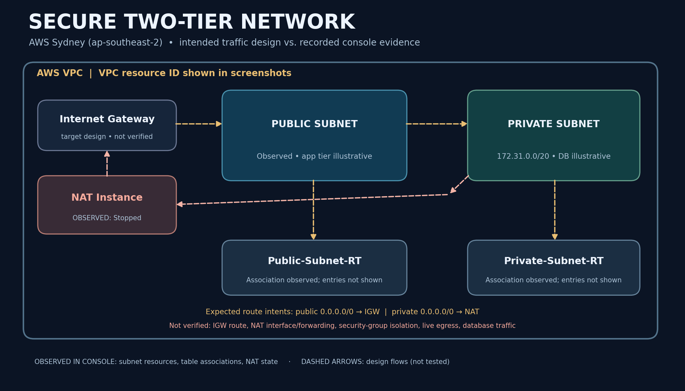
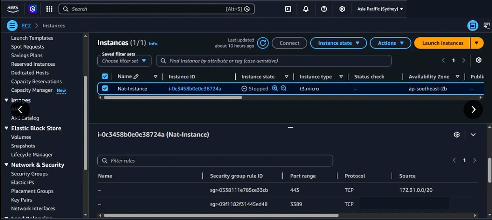
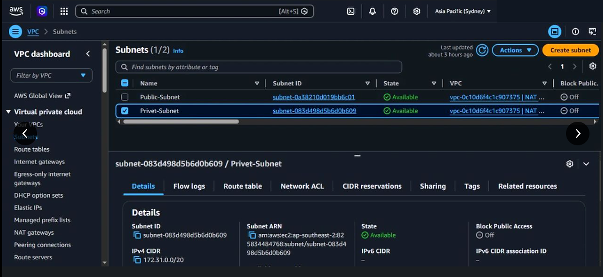
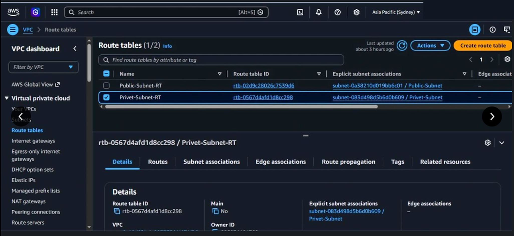

# Secure Two-Tier Network Architecture on AWS

**A hands-on VPC networking case study: public/private subnet segmentation, explicit route-table associations, NAT-instance investigation, and evidence-led cloud security reasoning.**



> **Project status — transparent by design:** Three original AWS console screenshots substantiate an EC2 NAT-instance resource, two subnet names, and two subnet-to-route-table associations in **Asia Pacific (Sydney), `ap-southeast-2`**. The NAT instance is visibly **Stopped** in the retained screenshot. This repository explains the intended two-tier design and how to validate it; it does **not** claim proven end-to-end NAT forwarding, a deployed database workload, a functioning web application, or production-grade security.

[Architecture](docs/ARCHITECTURE.md) · [Implementation guide](docs/IMPLEMENTATION.md) · [Validation report](docs/VALIDATION.md) · [Troubleshooting](docs/TROUBLESHOOTING.md) · [Evidence index](docs/EVIDENCE-INDEX.md) · **[Deep technical dive](DEEP-DIVE.md)**

---

## 01 — The problem worth solving

A flat cloud network makes it too easy to confuse **reachability** with **permission**. A virtual machine serving web requests might need public access. A database should not simply inherit that exposure. Both resources may be in one AWS account, but they have very different trust boundaries.

The engineering question behind this project is:

> **How do we separate an externally reachable application tier from a private backend tier, while keeping routing deliberate, access narrowly scoped, and outbound maintenance possible when needed?**

The exercise focused on understanding the AWS networking building blocks needed to answer that question:

- A VPC as the network boundary;
- public and private subnets as separate routing domains;
- custom route tables explicitly associated with their intended subnets;
- security groups as workload-level allowlists;
- an EC2-based NAT instance as a possible egress component, with its operational trade-offs.

This is an **architecture and configuration learning project**, not a claim that simply naming a subnet “private” makes its workloads secure.

## 02 — Actual work and visible results

| Area | What the retained evidence actually shows | What it does **not** establish |
|---|---|---|
| **Network segmentation** | `Public-Subnet` and `Privet-Subnet` (*original name as shown*) exist and show `Available`. The selected private subnet displays `172.31.0.0/20`. | No proof here of backend instances, effective routes or traffic isolation. |
| **Route-table associations** | `Public-Subnet-RT` is explicitly associated with `Public-Subnet`; `Privet-Subnet-RT` is explicitly associated with `Privet-Subnet`. | The **Routes** tab is not visible, so `0.0.0.0/0` destinations/targets cannot be confirmed. |
| **NAT resource** | EC2 instance named `Nat-Instance` exists, type `t3.micro`, in `ap-southeast-2b`. Status: **Stopped**. A security-group rule table is visible. | No NAT forwarding, public IP placement, source/destination-check setting, firewall behavior or successful private egress test is proven. |

**Why the distinction matters:** A working architecture is established through **data-plane tests**, not just cloud-console resource names. In a future validation pass, an engineer should prove both **allowed** and **denied** network flows.

## 03 — Architecture: intended design vs observed configuration

The target design follows the familiar two-tier pattern:

```text
Internet
   |
Internet Gateway (intended)
   |
Public Subnet  ---> application/web tier (illustrative)
   |               | route table: public default route -> IGW (to verify)
   |
NAT Instance (optional egress pattern, observed state: STOPPED)
   ^
   | private subnet's default route -> NAT (to verify)
   |
Private Subnet ---> backend/database tier (illustrative)
                    route table association observed
```

**Precise interpretation:** The image is a **design diagram**, not a screenshot of working traffic. The NAT instance's subnet attachment and configuration need further checking. Do not confuse the **VPC CIDR** with the **private subnet CIDR** displayed in evidence; only the latter (`172.31.0.0/20`) is explicitly readable.

For packet-level walkthroughs, [read the architecture notes](docs/ARCHITECTURE.md) and the [Deep Dive](DEEP-DIVE.md).

## 04 — Proof of work: original AWS console evidence

The files below are **legibility-enhanced versions of the user's original screenshots**. AWS account identifiers and one visible public source address have been masked for public sharing. No status or network configuration value was changed.

### Evidence A — NAT instance exists, but was stopped



An EC2 resource and inbound security-group entries appear. **Stopped** is not a healthy NAT datapath: an instance in this state cannot currently forward network packets.

### Evidence B — Separate subnet resources



The console shows two available subnets in the same listed VPC; the selected private subnet shows CIDR `172.31.0.0/20`. The original spelling `Privet-Subnet` is preserved in the screenshot; explanatory documentation uses “private subnet.”

### Evidence C — Explicit subnet/route-table associations



Separate named route tables are associated with their respective subnets. **Association** is evidence of organization, not proof of the specific route entries.

[Full evidence interpretation and claims matrix →](docs/EVIDENCE-INDEX.md)

## 05 — The most important engineering decisions

| Decision | Why it matters | Verification that should follow |
|---|---|---|
| Use separate subnet routing domains | Different tiers can require different destinations and egress rules | Inspect every relevant route, not just the table name |
| Explicitly associate route tables | Removes ambiguity about which table controls each subnet | Compare subnet IDs and route table associations |
| Keep the backend private | Limits direct inbound internet paths | Confirm no IGW default route, no unintended public addressing, and restrictive SG rules |
| Treat NAT as **outbound**, not general inbound access | Private machines can initiate updates without public listener access | Test private-initiated egress and reject unsolicited inbound connections |
| Examine EC2 NAT-instance lifecycle | A stopped/unhealthy self-managed instance becomes an egress outage | Check instance state, source/destination check, packet forwarding, route target and DNS |
| Prefer managed NAT Gateway in many production cases | Managed service reduces patching and self-managed instance risks | Evaluate AZ design, cost, throughput and recovery expectations |

An operationally sound network needs **route policy + identity/permissions + actual flow validation**. A subnet name is only a label.

## 06 — What I'd test before calling this deployment verified

1. **Route audits:** Inspect the public route to the IGW and the private route to the chosen NAT target. Record target state and route status.
2. **Security-group boundaries:** Verify app/backend inbound and outbound restrictions using exact protocols, ports and sources. Remove unnecessary broad access.
3. **NAT forwarding:** Only after safe configuration, confirm running state, disabled source/destination check on the NAT instance, IPv4 forwarding and translation rules. Treat these as verification tasks—not completed facts.
4. **Positive test:** From a genuinely private workload, make an outbound HTTPS request and record DNS, TCP and HTTP outcomes.
5. **Negative test:** Confirm an unapproved inbound path to the private tier is not reachable.
6. **Failure test:** Stop the NAT instance in a controlled lab and observe outbound failure/recovery; document resulting blast radius. Do not disrupt a shared or production environment.
7. **Operational review:** Validate logging, reachability analysis, monitoring, patching, least privilege and cleanup costs.

[Full verification checklist →](docs/VALIDATION.md)

## 07 — Repository map

```text
aws-secure-two-tier-network/
├── README.md                     # Recruiter-facing project story & real screenshots
├── DEEP-DIVE.md                  # Networking and security: beginner → advanced
├── docs/
│   ├── ARCHITECTURE.md           # Components, packet journeys, trust boundaries
│   ├── IMPLEMENTATION.md         # Reproducible console/CLI investigation guide
│   ├── VALIDATION.md             # Observed vs. not-yet-proven claims
│   ├── TROUBLESHOOTING.md        # Practical failure analysis and diagnosis
│   └── EVIDENCE-INDEX.md         # What each screenshot really proves
├── diagrams/
│   └── architecture.png          # Design diagram, explicitly labeled
└── evidence/
    ├── 01-nat-instance-stopped.png
    ├── 02-public-private-subnets.png
    └── 03-public-private-route-tables.png
```

This repository intentionally contains **no invented Terraform, CloudFormation, deployment script or application source**. The original work was demonstrated through the AWS console, and source configuration exports were not supplied. Reproduction guidance is provided separately from historical evidence.

## 08 — Skills demonstrated and engineering reflection

`Amazon VPC` · `EC2` · `subnet segmentation` · `route-table association` · `NAT fundamentals` · `security groups` · `network threat modeling` · `evidence-led documentation`

**What I learned:** Creating cloud resources is the start of an engineering task; **proving the allowed traffic path, the denied traffic path, and the behavior during failure** is the finish. A screenshot that says “Stopped” is not a weakness to hide—it is an operational state to recognize and investigate.

**Study further:** [Deep Dive](DEEP-DIVE.md) covers packet journeys, CIDR math, NAT/PAT, source/destination checks, SG/NACL behavior, observability, high availability, security, cost, practical labs and interview questions.

---

**Maintainer:** Hafiz Mohammad Sunasara  
**Track:** Hands-on AWS Cloud & DevOps engineering portfolio  
**Region in retained screenshots:** `ap-southeast-2` (Sydney)  
**Evidence status:** Configuration partially observed; end-to-end network validation not archived  
**Scope:** Educational infrastructure implementation / case study; not production certification or professional deployment evidence

### Documentation references

- [AWS — Subnet route tables](https://docs.aws.amazon.com/vpc/latest/userguide/subnet-route-tables.html)
- [AWS — NAT devices](https://docs.aws.amazon.com/vpc/latest/userguide/vpc-nat.html)
- [AWS — NAT instances](https://docs.aws.amazon.com/vpc/latest/userguide/work-with-nat-instances.html)
- [AWS — Security group rules](https://docs.aws.amazon.com/vpc/latest/userguide/security-group-rules.html)
